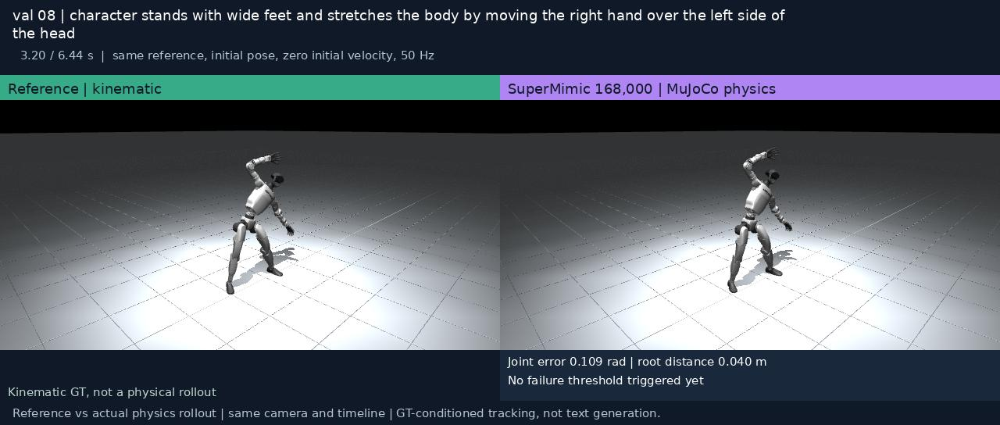
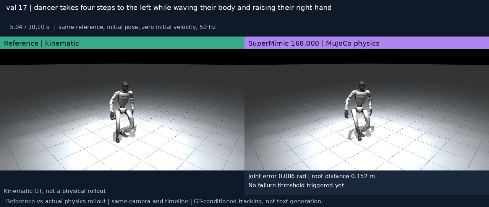
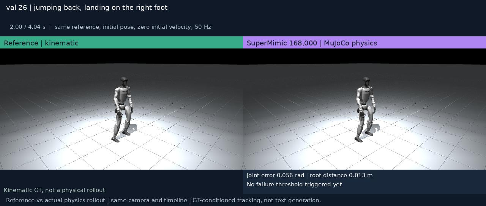
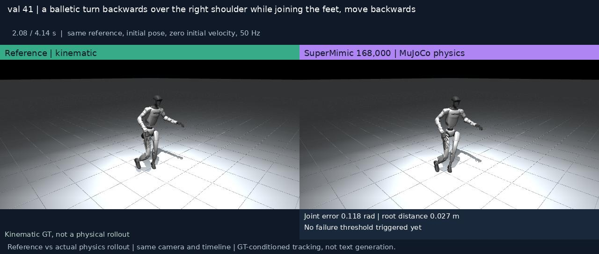
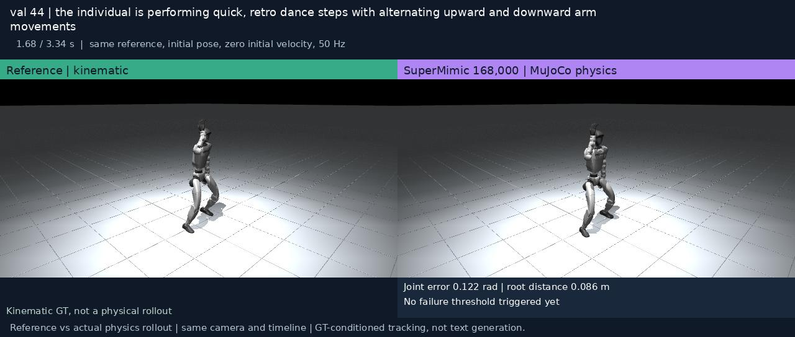
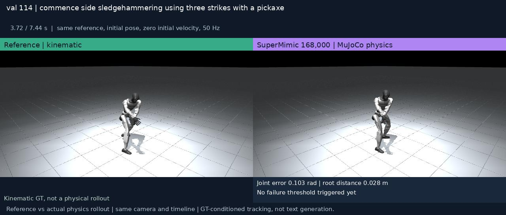

# SuperMimic G1

**Independent reproduction · Differentiable world-model control · MuJoCo Warp**

A reference-motion-conditioned whole-body controller for Unitree G1, using a learned differentiable world model and short-horizon BPTT actor–critic training in **MuJoCo Warp / mjlab**.

This is an independent reproduction **derived from [CuboiLeo/SuperMimic-Reproduced](https://github.com/CuboiLeo/SuperMimic-Reproduced), commit `d9be385b3eeb13a638fb33fb200d3bfd9be9839f`**. It is not the authors' official implementation. The original work is [SuperMimic: Scaling Humanoid Whole-Body Control with One Differentiable World Model](https://arxiv.org/abs/2610.28480) ([project](https://supermimic.github.io/)).

**Release state:** matching **168k weights and demos** are available in [v0.2.0-168k](https://github.com/kangzejian1896/supermimic-g1-reproduction/releases/tag/v0.2.0-168k). The checkpoint was selected by the best mean native validation return among completed evaluations through 172k on 2026-10-24. Code is MIT; weight distribution authorization is confirmed by the publisher; separate weight terms remain pending. See [WEIGHTS_NOTICE.md](WEIGHTS_NOTICE.md).

[24-example comparison video](docs/media/reference_supermimic_168000_all.mp4) · [Demo gallery](docs/index.html) · [Model card](docs/MODEL_CARD.md) · [Paper alignment](docs/PAPER_ALIGNMENT.md) · [Data format](docs/DATA.md)

## Training at a glance

| Checkpoint | Training GPU | Training data | Time to checkpoint |
|:--|:--|:--|:--|
| **168,000 iterations** · seed 42 | **1 × NVIDIA A800-SXM4-80GB** | **84,287 clips · 170.11 motion hours** | **25.86 hours ≈ 25 h 52 min** |

The processed BONES-SEED datav5 train split contains **30,619,722 frames at 50 Hz**. Training uses **4,096 parallel environments**, with about **24 GB observed GPU allocation**. The **128 held-out validation clips** are also used for checkpoint selection; no final test result is claimed. Logged training time excludes additional evaluation/rendering GPU time. This is an intermediate checkpoint of a 320k schedule.

## Validation demos · 168k

**Left: kinematic reference. Right: actual SuperMimic MuJoCo Warp rollout.** The released weights match these videos. Shared camera, original speed, full duration, identical initial pose and zero initial velocity. Reference-conditioned tracking: the displayed text is a motion label, not a policy input.

[](docs/media/reference_supermimic_168000_all.mp4)

**[Play / download the full video — 24 validation examples, 3 min 25 s](docs/media/reference_supermimic_168000_all.mp4)**

The [local gallery](docs/index.html) includes the full video and the six owner-selected examples below. Run `python3 -m http.server 8000` from the repository root and open `http://localhost:8000/docs/`.

### val 08 · Side stretch

[](docs/media/val_08.mp4)

### val 17 · Lateral dance

[](docs/media/val_17.mp4)

### val 26 · Backward jump

[](docs/media/val_26.mp4)

### val 41 · Balletic turn

[](docs/media/val_41.mp4)

### val 44 · Retro dance

[](docs/media/val_44.mp4)

### val 114 · Pickaxe strikes

[](docs/media/val_114.mp4)

### Same-protocol validation comparison

| Checkpoint | Completed / 128 ↑ | Joint RMSE ↓ | Root-position RMSE ↓ |
|:--|--:|--:|--:|
| 32k | 128 | 0.1271 rad | 0.2138 m |
| **168k** | **128** | **0.0882 rad** | **0.1312 m** |

Means are over all 128 full trajectories, including frames after failure. Joint error falls **30.6%**, root-position error **38.6%**. Completion uses height/tilt thresholds and does not imply perfect tracking. The visualization protocol differs from the native reward benchmark: **168k native mean return 0.9290**, versus **0.8854 at 32k**. Videos are fixed presentation examples, not a random evaluation sample.

[Demo protocol and hashes](docs/demo_manifest.json) · [Native benchmark](docs/benchmark_168k.json) · Motion Data by [Bones Studio](https://bones.studio/).

## What is included

- World model, differentiable kinematics, analytic rewards, policy and critic, replay, training and evaluation.
- Opt-in `paper_protocol`: per-episode COM randomization, pelvis reference anchor, full-reference return normalization, and packed-library evaluation that retains parallel environments.
- Portable policy-only and policy/world-model/critic exports, with checksums and identical policy outputs after export.
- Model-only initialization for new training data, atomic checkpoint writes, and a synthetic smoke example that needs no motion dataset.

**Inputs:** 10 frames of proprioception (930 values) and 10 future reference frames (680 values). **Output:** 29 joint-position control actions at 50 Hz. No text embeddings, TRACE conditioning, or text-to-motion generation are included. Physical simulation uses 4 substeps of 5 ms each.

## Install

Linux, Python 3.12 and a CUDA-capable NVIDIA GPU are required for physics training/evaluation. The tested training device was one A800 80GB; observed training allocation was about 24GB. That is an observed configuration, not a guaranteed minimum. See [tested runtime](docs/tested-runtime.txt).

From the repository root, with [uv](https://docs.astral.sh/uv/) installed:

```bash
uv sync --frozen --group dev
# Avoid accidentally importing Python packages from ROS/other environments.
env -u PYTHONPATH uv run pytest tests -q
```

The upstream lockfile and mjlab revision are retained. `pyproject.toml` configures the PyTorch CUDA 13.0 and NVIDIA package indexes. mjlab supplies its G1 robot asset; third-party dependency/asset licenses remain applicable. No robot meshes are vendored here.

## Try without a motion dataset

Generate a short, constant reference from the robot's home pose:

```bash
uv run python scripts/data/make_synthetic_motion.py
# Place the prepared release weights in weights/ first.
CUDA_VISIBLE_DEVICES=0 MUJOCO_GL=egl uv run python scripts/eval_benchmark.py \
  --ckpt weights/supermimic_g1_168000_policy.pt \
  --npz-dir data/npz/synthetic --num-envs 1 --out logs/synthetic_eval.json
```

This verifies the interface, not realistic tracking quality. To view motions you have prepared:

```bash
CUDA_VISIBLE_DEVICES=0 uv run python scripts/play.py \
  --ckpt weights/supermimic_g1_168000_policy.pt \
  --npz-dir data/npz/motions --num-envs 1 --viewer viser
```

The viewer shows a reference ghost and the simulated robot. Its environment protocol is read from the checkpoint, including the pelvis anchor. The policy acts on reference motion, not on the dataset's text labels.

## Prepare data and train

Acquire motion data under its applicable license; none is shipped in this repository. Supply headerless G1 CSVs in meters/radians, root quaternion **xyzw**, and the documented joint order. For raw BONES-SEED CSV conventions, see [DATA.md](docs/DATA.md); do not feed centimeter/Euler files directly into this converter.

```bash
uv run python scripts/data/csv_to_npz_batch.py \
  --input-dir data/csv/train --output-dir data/npz/train --input-fps 50
uv run python scripts/data/build_library.py \
  --npz-dir data/npz/train --out data/library/train.pt
CUDA_VISIBLE_DEVICES=0 bash scripts/train_paper.sh \
  --run-name g1_paper_seed42 --data.library data/library/train.pt
```

Defaults: 4096 environments, world-model horizon 8, imagination horizon 32, policy batch 4096, world-model batch 2048, seed 42, and a 320,000-iteration schedule. The paper's 3-hour result is a performance milestone on H100, not this full schedule's duration. `configs/paper_protocol.json` records the experiment configuration; CLI flags configure the trainer. Use a fresh run name to avoid overwriting earlier logs.

To initialize a new training run from the released model tensors:

```bash
CUDA_VISIBLE_DEVICES=0 bash scripts/train_paper.sh \
  --run-name g1_finetune --data.library data/library/train.pt \
  --initialize-from weights/supermimic_g1_168000_models.pt
```

`--initialize-from` resets optimizer, replay/sampling state and iteration counters. It is different from `--resume`, which requires a complete private training checkpoint and a compatible dataset. Public exports deliberately omit optimizer state and per-motion sampling statistics.

## Evaluate

```bash
CUDA_VISIBLE_DEVICES=0 MUJOCO_GL=egl uv run python scripts/eval_benchmark.py \
  --ckpt weights/supermimic_g1_168000_policy.pt \
  --npz-dir data/npz/val --num-envs 128 --out logs/val.json
# Packed libraries are also supported; one .pt can contain many motions.
CUDA_VISIBLE_DEVICES=1 MUJOCO_GL=egl uv run python scripts/eval_benchmark.py \
  --ckpt weights/supermimic_g1_168000_policy.pt \
  --library data/library/train.pt --num-envs 1024 --out logs/train_eval.json
```

Evaluate immutable numbered checkpoints on a separate GPU if training is running. `sm-train` saves checkpoints but does not automatically launch benchmark jobs. The benchmark uses the full reference horizon as the denominator in `paper_protocol`; early failure earns zero reward for the remaining duration. Legacy executed-step normalization is retained separately for diagnostics.

## Model downloads

Download [v0.2.0-168k](https://github.com/kangzejian1896/supermimic-g1-reproduction/releases/tag/v0.2.0-168k) assets and verify `SHA256SUMS_168k`:

| Artifact | Contents | Purpose |
|---|---|---|
| `supermimic_g1_168000_policy.pt` | Policy + portable config | Inference matching current demos |
| `supermimic_g1_168000_models.pt` | Policy, world model, critic + config | Model-only training initialization |
| `reference_supermimic_168000_all.mp4` | 24 full-length validation examples | Ref / control comparison |

Put model files in `weights/`. Restricted loading (`weights_only=True`) and identical policy outputs after export are verified. Optimizer states, replay, per-motion scores, raw motion data and internal filesystem paths are excluded. Use `--initialize-from` with the models export; exact optimizer resumption is not supported. Older 32k/36k assets remain in v0.1.0-rc1.

## Attribution and licenses

Code: [MIT](LICENSE), preserving the original copyright notice. Changes and provenance: [NOTICE.md](NOTICE.md), [CHANGELOG.md](CHANGELOG.md). Model weights: [WEIGHTS_NOTICE.md](WEIGHTS_NOTICE.md), **not automatically MIT**.

**Training data includes [Motion Data by Bones Studio](https://bones.studio/). Use of the underlying dataset is subject to the BONES Motion Capture Dataset License Agreement.** Obtain data from [bones-studio/seed](https://huggingface.co/datasets/bones-studio/seed) under its license. Dataset access or redistribution rights are not granted by this repository.

Please cite the original SuperMimic paper and acknowledge CuboiLeo's reproduction when using this implementation. This fork's measured results must not be attributed to the original authors. No real-robot deployment or full-paper performance reproduction is claimed.
